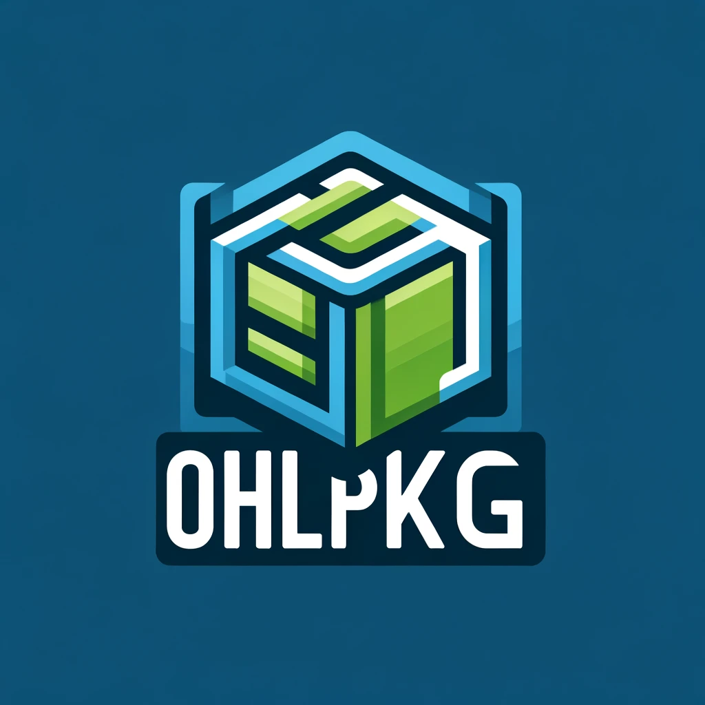

# OHLpkg

### Ontario Hockey League Statistics Tools for R

[](https://github.com/NoahCornish/OHLpkg/releases)
[](https://github.com/NoahCornish/OHLpkg)
[](https://github.com/NoahCornish/OHLpkg/issues)
[](https://github.com/NoahCornish/OHLpkg/releases)
[](https://github.com/NoahCornish/OHLpkg)
[](https://github.com/NoahCornish/OHLpkg/blob/main/LICENSE)

<p align="center">
  
</p>

`OHLpkg` is an R package created by **Noah Cornish** for retrieving and analyzing Ontario Hockey League (OHL) data.

The package provides clean skater and goalie statistics, original HockeyTech statistical fields, team information, schedules, special-teams production, rookie and draft-eligible player data, individual game events, and player draft histories.

---

## What Can OHLpkg Do?

With `OHLpkg`, you can:

- Retrieve current and historical OHL skater statistics.
- Work with all available original player-statistics fields using `get_AllRawStats()`.
- Retrieve player IDs, birthdates, and direct OHL headshot URLs.
- Filter statistics by one or multiple teams and apply minimum-games requirements where supported.
- Retrieve goalie statistics.
- Analyze even-strength, power-play, and short-handed production.
- Examine penalty minutes and penalty minutes per game.
- Identify rookies and first-time NHL draft-eligible skaters.
- Retrieve OHL Priority, U18 Priority, CHL Import, and NHL draft information from official player profiles.
- Identify draft acquisition types and available free-agent information.
- Retrieve player biographical and team information.
- View schedules, game results, and individual-game play-by-play events.
- View supported season names and their IDs.

Functions return R data frames for analysis, visualization, and export.

> **Data availability:** An internet connection is required. `OHLpkg` uses externally maintained OHL/HockeyTech data feeds and official player profiles. Available fields and records vary by source and season.

---

## Installation

Install the development version from GitHub:

```r
if (!requireNamespace("remotes", quietly = TRUE)) {
  install.packages("remotes")
}

remotes::install_github("NoahCornish/OHLpkg")
```

Load the package:

```r
library(OHLpkg)
packageVersion("OHLpkg")
```

> This README describes **version 2.7.0**. If that version has not yet been published on GitHub, the installation command above will install the latest version currently available there.

---

## Start Here

```r
library(OHLpkg)

# View supported season names and IDs
get_Seasons()

# Retrieve active skater statistics for 2026–27
players <- get_RawStats("2027 Season")

head(players)
```

Seasons are named for the year in which they end:

```text
"2027 Season"     = 2026–27 OHL regular season
"2026 Season"     = 2025–26 OHL regular season
"2026 Playoffs"   = 2026 OHL playoffs
"2026 Pre-Season" = 2025–26 OHL preseason
```

Use season names exactly as displayed by `get_Seasons()`.

---

## Player Statistics

### Retrieve every active skater without a games-played cutoff

`get_RawStats()` returns standardized player statistics with readable column names:

```r
raw_stats <- get_RawStats(season_name = "2027 Season")
head(raw_stats)
```

The result includes:

- `PlayerID` — HockeyTech player identifier.
- `PhotoURL` — direct OHL headshot URL derived from the player's ID.

```r
raw_stats[1:5, c("Name", "PlayerID", "PhotoURL")]
```

### Retrieve all original raw API columns — New in 2.7.0

`get_AllRawStats()` preserves **all fields supplied by the player-statistics feed**, using their original API column names.

This is useful when you need additional metrics, such as faceoff statistics, that are not included in the standardized statistical functions.

```r
all_raw <- get_AllRawStats(
  season_name = "2027 Season"
)

nrow(all_raw)
ncol(all_raw)
names(all_raw)

# Find faceoff-related columns
grep(
  "faceoff",
  names(all_raw),
  value = TRUE
)
```

Filter by team:

```r
peterborough_raw <- get_AllRawStats(
  season_name = "2027 Season",
  team = "Peterborough Petes"
)

head(peterborough_raw)
```

The original API fields are retained, and their availability may change between seasons.

`get_AllRawStats()` is distinct from `get_RawStats()`, which presents a selected, standardized set of statistical columns.

### Apply a minimum-games requirement

`get_Stats()` includes players with at least 10 games played by default:

```r
player_stats <- get_Stats(
  season_name = "2027 Season"
)
```

To include players regardless of games played:

```r
player_stats <- get_Stats(
  season_name = "2027 Season",
  min_games = 0
)
```

### Filter by one or multiple teams

```r
london_stats <- get_Stats(
  season_name = "2027 Season",
  min_games = 0,
  team = "London Knights"
)

head(london_stats)
```

Multiple teams can be supplied as a character vector:

```r
team_subset <- get_Stats(
  season_name = "2027 Season",
  min_games = 0,
  team = c("Erie Otters", "Saginaw Spirit")
)

head(team_subset)
```

Use `get_Teams()` to check team names.

---

## Player Draft Data — New in 2.7.0

`get_DraftData()` retrieves draft information from official OHL player profiles.

The function supports:

- Individual player ID searches.
- Multiple player ID searches.
- Team-specific searches.
- Season-wide searches.
- Optional CSV export.

### Available Draft Information

The function retrieves separate draft information for four categories:

**OHL Priority Selection**
- `OHLDraftYear`
- `OHLDraftRound`
- `OHLDraftOverall`
- `OHLDraftTeam`

**OHL U18 Priority Selection**
- `U18DraftYear`
- `U18DraftRound`
- `U18DraftOverall`
- `U18DraftTeam`

**CHL Import Draft**
- `ImportDraftYear`
- `ImportDraftRound`
- `ImportDraftOverall`
- `ImportDraftTeam`

**NHL Entry Draft**
- `NHLDraftYear`
- `NHLDraftRound`
- `NHLDraftOverall`
- `NHLDraftTeam`

Additional information includes:

- `PlayerID` — OHL player identifier.
- `Name` — Player name.
- `DOB` — Date of birth, when available.
- `Pos` — Player position, when available.
- `AcquisitionType` — Identified OHL acquisition method.
- `FreeAgent` — Logical free-agent classification.
- `ProfileStatus` — Profile retrieval or parsing status.
- `ProfileURL` — Official OHL player profile link.

### Search by PlayerID

Retrieve draft information for a specific player:

```r
draft <- get_DraftData(
  player_id = 9118
)

head(draft)
```

Retrieve multiple players:

```r
draft_players <- get_DraftData(
  player_id = c(9118, 9638)
)

head(draft_players)
```

### Search by Team and Season

Team and season searches use `get_AllRawStats()` to retrieve player IDs before obtaining their draft profiles.

```r
petes_draft <- get_DraftData(
  season_name = "2027 Season",
  team = "Peterborough Petes"
)

head(petes_draft)
```

Retrieve draft information for all players returned by a season:

```r
season_draft <- get_DraftData(
  season_name = "2027 Season"
)

head(season_draft)
```

### Export Draft Information to CSV

```r
get_DraftData(
  season_name = "2027 Season",
  team = "Peterborough Petes",
  csv_file = "Peterborough_DraftData.csv"
)
```

The resulting CSV contains the available draft information and classifications for the retrieved players.

### Free-Agent Classification

The `FreeAgent` column is determined from available OHL acquisition information:

- `FALSE` — A recognized OHL Priority, U18, or CHL Import Draft selection was found.
- `TRUE` — A successfully interpreted draft section indicates no recognized OHL, U18, or Import Draft selection.
- `NA` — Draft information could not be determined reliably.

NHL draft status does not determine OHL free-agent status.

> **Note:** Draft searches retrieve individual player profiles and may take longer than ordinary statistics requests. Users should review `ProfileStatus` and verify important draft classifications against official OHL records.

Season-wide coverage depends on the player IDs returned by `get_AllRawStats()`.

---

## Goalie Statistics

Retrieve all goalies from the current season:

```r
goalie_stats <- get_GoalieStats(
  season_name = "2027 Season",
  min_games = 0
)

head(goalie_stats)
```

Filter by team:

```r
london_goalies <- get_GoalieStats(
  season_name = "2027 Season",
  team = "London Knights",
  min_games = 0
)

head(london_goalies)
```

The default minimum is 10 games if `min_games` is not specified.

---

## Even-Strength Statistics

`get_EVStats()` calculates:

- Even-strength goals (`EVG`)
- Even-strength assists (`EVA`)
- Even-strength points (`EVPTS`)
- Even-strength points per game (`EVPTS/G`)
- Percentage of total points recorded at even strength (`EVPTS%`)

```r
ev_stats <- get_EVStats(
  season_name = "2027 Season",
  min_games = 0
)

head(ev_stats)
```

---

## Power-Play Statistics — New in 2.7.0

`get_PPStats()` returns:

- Power-play goals (`PPG`)
- Power-play assists (`PPA`)
- Power-play points (`PPP`)
- Power-play points per game (`PPP/G`)
- Percentage of total points recorded on the power play (`PPP%`)

```r
pp_stats <- get_PPStats(
  season_name = "2027 Season",
  min_games = 0
)

head(pp_stats)
```

Filter by team:

```r
london_pp <- get_PPStats(
  season_name = "2027 Season",
  team = "London Knights",
  min_games = 0
)

head(london_pp)
```

---

## Short-Handed Statistics

`get_SHStats()` returns short-handed goals, assists, points, points per game, and the percentage of total production recorded short-handed.

```r
sh_stats <- get_SHStats(
  season_name = "2027 Season",
  min_games = 0
)

head(sh_stats)
```

---

## Penalty-Minute Statistics — New in 2.7.0

`get_PIMStats()` returns:

- Total penalty minutes (`PIM`)
- Penalty minutes per game (`PIM/G`)

```r
pim_stats <- get_PIMStats(
  season_name = "2027 Season",
  min_games = 0
)

head(pim_stats)
```

Filter by team:

```r
london_pim <- get_PIMStats(
  season_name = "2027 Season",
  team = "London Knights",
  min_games = 0
)

head(london_pim)
```

---

## Draft-Eligible Players

`get_DYStats()` identifies first-time NHL draft-eligible skaters based on birthdate.

This differs from `get_DraftData()`, which retrieves recorded draft selections and acquisition information.

```r
draft_year_stats <- get_DYStats(
  season_name = "2027 Season",
  min_games = 0
)

head(draft_year_stats)
```

For `"2027 Season"`, the first-time NHL draft-eligibility birthdate range is:

```text
September 16, 2008 through September 15, 2009
```

The package calculates the appropriate birthdate range automatically for other supported seasons.

---

## Rookie Statistics

`get_RKStats()` uses the OHL feed's rookie indicator.

```r
rookie_stats <- get_RKStats(
  season_name = "2027 Season",
  min_games = 0
)

head(rookie_stats)
```

Filter by team:

```r
london_rookies <- get_RKStats(
  season_name = "2027 Season",
  team = "London Knights",
  min_games = 0
)

head(london_rookies)
```

---

## Player Information

`get_PlayerInfo()` retrieves available player biographical information:

- Player ID
- Player name
- Height
- Weight
- Birthdate
- Team name
- Team ID

```r
player_info <- get_PlayerInfo(
  season_name = "2027 Season"
)

head(player_info)
```

---

## Team Information

Retrieve all teams represented in the current season:

```r
teams <- get_Teams()

teams
```

Retrieve teams from another supported season:

```r
previous_teams <- get_Teams(
  season_name = "2026 Season"
)
```

Filter the result:

```r
selected_teams <- get_Teams(
  team = c("London Knights", "Oshawa Generals")
)
```

---

## Current Schedule

Retrieve the current 2026–27 OHL schedule and available game results:

```r
schedule <- get_Schedule()

head(schedule)
```

The schedule includes:

- Game date
- Game ID
- Scheduled time
- Home team
- Home score
- Visiting team
- Visiting score

The `ID` column identifies games that can be supplied to `get_GameEvents()`.

---

## Individual Game Events

Retrieve the schedule:

```r
schedule <- get_Schedule()
```

Find games with recorded scores:

```r
completed_games <- schedule[
  !is.na(schedule$HomeGoals) &
    !is.na(schedule$VisitorGoals),
]

head(completed_games)
```

Retrieve play-by-play events using a game ID:

```r
if (nrow(completed_games) > 0L) {
  game_events <- get_GameEvents(
    game_id = completed_games$ID[1L]
  )

  head(game_events)
}
```

---

## Function Reference

| Function | Purpose | Main Arguments |
|---|---|---|
| `get_Seasons()` | List supported seasons and IDs | None |
| `get_RawStats()` | Standardized skater statistics, player IDs, and headshot URLs | `season_name`, `team` |
| `get_AllRawStats()` | Retrieve all original statistical columns from the OHL API | `season_name`, `team` |
| `get_Stats()` | Retrieve skaters using a minimum-games cutoff | `season_name`, `min_games`, `team` |
| `get_DraftData()` | Retrieve OHL, U18, Import, and NHL draft information | `player_id`, `season_name`, `team`, `pause`, `csv_file` |
| `get_GoalieStats()` | Retrieve goalie statistics | `season_name`, `team`, `min_games` |
| `get_EVStats()` | Calculate even-strength production | `season_name`, `team`, `min_games` |
| `get_PPStats()` | Retrieve power-play production | `season_name`, `team`, `min_games` |
| `get_SHStats()` | Retrieve short-handed production | `season_name`, `team`, `min_games` |
| `get_PIMStats()` | Retrieve penalty-minute statistics | `season_name`, `team`, `min_games` |
| `get_DYStats()` | Retrieve first-time NHL draft-eligible skaters | `season_name`, `team`, `min_games` |
| `get_RKStats()` | Retrieve rookie skaters | `season_name`, `team`, `min_games` |
| `get_PlayerInfo()` | Retrieve player biographical information | `season_name`, `team` |
| `get_Teams()` | Retrieve team information | `team`, `season_name` |
| `get_Schedule()` | Retrieve the current schedule and results | None |
| `get_GameEvents()` | Retrieve play-by-play events | `game_id` |

### Package Documentation

Open the package help page:

```r
help(package = "OHLpkg")
```

Open documentation for individual functions:

```r
?get_Stats
?get_GoalieStats
?get_AllRawStats
?get_DraftData
?get_PPStats
```

---

## Common Questions

### Why did `get_Stats()` return no players?

The default minimum is 10 games.

Early in a season, players may not have reached that threshold.

Use:

```r
get_Stats(
  season_name = "2027 Season",
  min_games = 0
)
```

### How do I find the correct season name?

Run:

```r
get_Seasons()
```

Season names are case-sensitive and should be entered exactly as displayed.

### How do I find the correct team name?

Run:

```r
get_Teams()
```

### What's the difference between `get_RawStats()` and `get_AllRawStats()`?

`get_RawStats()` returns a selected, standardized collection of active skater statistics with readable column names.

`get_AllRawStats()` preserves every column returned by the underlying player-statistics API, including additional statistical categories.

### What's the difference between `get_DYStats()` and `get_DraftData()`?

`get_DYStats()` identifies skaters eligible for a particular NHL draft year.

`get_DraftData()` retrieves recorded draft selections and OHL acquisition information from individual player profiles.

### Why is `get_DraftData()` slower than other functions?

`get_DraftData()` requests individual player profiles rather than retrieving all draft information from one API response.

The `ProfileStatus` column helps identify unavailable profiles and unrecognized information.

### Why did I receive an empty data frame?

The selected season may be recognized by the package before statistics have been published by the OHL data feed.

### Why did I receive an API error?

`OHLpkg` depends on external online data sources.

Temporary connection problems, unavailable records, or changes to the source feed may affect data retrieval.

---

## Version 2.7.0

Version 2.7.0 expands OHLpkg with new skater statistics functions, complete raw player data access, player draft histories, improved internal organization, and significantly expanded automated testing.

### New Features

- Added `get_PPStats()` for power-play statistics.
  - Includes `PPG`, `PPA`, `PPP`, `PPP/G`, and `PPP%`.
  - Supports team and minimum-games filtering.

- Added `get_PIMStats()` for penalty-minute statistics.
  - Includes `PIM` and `PIM/G`.
  - Supports team and minimum-games filtering.

- Added `get_AllRawStats()` for retrieving every available column from the OHL player-statistics feed.
  - Preserves original API field names.
  - Includes additional faceoff, shooting, and other available statistical fields.
  - Supports season and team filtering.

- Added `get_DraftData()` for retrieving player draft histories.
  - Supports OHL Priority, U18 Priority, CHL Import, and NHL draft categories.
  - Includes draft year, round, overall selection, and drafting team.
  - Adds acquisition and free-agent classifications.
  - Supports PlayerID searches, season and team filtering, and optional CSV export.

- Added `PlayerID` and `PhotoURL` to `get_RawStats()`.
  - `PlayerID` exposes the HockeyTech player identifier.
  - `PhotoURL` provides a direct OHL player headshot URL.

### Improvements

- Standardized source filenames so public functions use matching `.R` filenames.
- Improved consistency across `get_EVStats()`, `get_PPStats()`, and `get_SHStats()`.
- Standardized special-teams sorting behaviour.
- Updated `get_EVStats()` to use even-strength goals as a secondary sorting criterion.
- Improved documentation and package organization.
- Added `rvest` as a dependency for official player-profile retrieval.
- Introduced `NEWS.md` as the permanent changelog.

### Testing

Automated test coverage has been expanded across the package's public API.

The reported development test run contains:

- **156 passing expectations**
- **0 failures**
- **0 warnings**
- **0 skipped tests**

New tests include coverage for `get_AllRawStats()` and `get_DraftData()`.

For complete details, see [NEWS.md](NEWS.md).

---

## Version 2.6.0

Version 2.6.0 added support for the 2026–27 OHL season and improved the package's internal structure.

### Changes

- Added `"2027 Season"` using season ID `88`.
- Added `"2026 Pre-Season"` using season ID `87`.
- Added `"2026 Playoffs"` using season ID `85`.
- Added `get_Seasons()`.
- Centralized season names and IDs.
- Updated current-season defaults to `"2027 Season"`.
- Added clearer season and argument validation.
- Added safer handling for empty and unavailable data.
- Added customizable minimum-games filters.
- Expanded optional team filtering.
- Removed unnecessary package dependencies.
- Removed in-function `library()` calls.
- Improved documentation and package-check compatibility.

---

## Data Availability

Data availability varies by season and statistic.

Some older seasons may not contain every field available in recent seasons.

A season may also be recognized before statistics are published.

Draft information is retrieved from official player profiles and may not always be available or successfully interpreted.

Use:

```r
get_Seasons()
```

to view the season names currently supported by the package.

---

## Reporting Problems

If you find a problem, unexpected result, or change in the OHL data feed, please open an issue:

[Report an OHLpkg issue](https://github.com/NoahCornish/OHLpkg/issues)

When reporting a problem, include:

- The function you used.
- The season name.
- Any team or minimum-games filters.
- The complete warning or error message.
- Your installed version of `OHLpkg`.

Check the installed version with:

```r
packageVersion("OHLpkg")
```

---

## Disclaimer

`OHLpkg` is an independent project and is not affiliated with or endorsed by the Ontario Hockey League or Canadian Hockey League.

The package depends on externally maintained data feeds and official player profiles.

Data availability, field names, website structure, and source accuracy may change without notice.

---

## License

`OHLpkg` is available under the MIT License.

---

## Author

Created and maintained by **Noah Cornish**.

- [GitHub](https://github.com/NoahCornish)
- [X/Twitter](https://twitter.com/NoahCornish)
